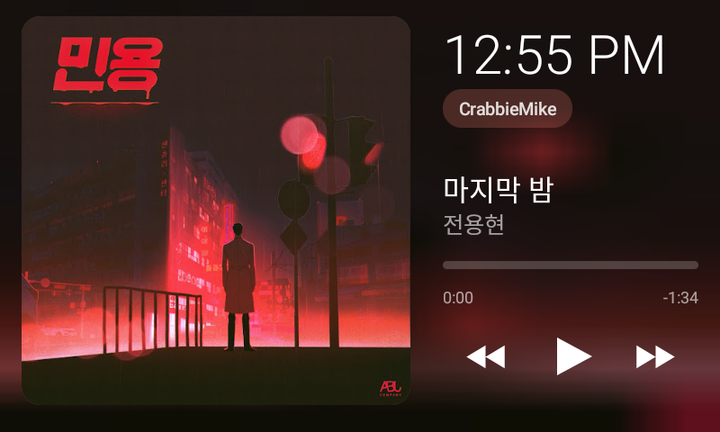

# Lenovo Smart Clock: Now Playing

Turns a Lenovo Smart Clock (with ADB access) into a now-playing display for a Linux PC. It shows the album art over a blurred backdrop tinted to match the cover, the title and artist, a seek bar, and play/pause/skip buttons. The clock's hardware volume buttons control whatever is playing. When nothing is playing, it shows a big clock with the date and weather.

| | | |
|---|---|---|
|  |  |  |

## How it works

The clock runs a small launcher app (`app/`) that polls a tiny HTTP server on the PC:

`pc/musicbridge.py` reads MPRIS over D-Bus, so it works with Spotify, browsers and most players. It serves the track, the art, and play/pause/next/seek/volume on port 8765.

## Setup

1. **Get ADB on the clock.** Mine is modded with ADB over Wi-Fi https://github.com/SychPL/smartclock2tool
2. **Set your weather location.** Edit the latitude/longitude in `ClockActivity.fetchWeather()`. Weather comes from [Open-Meteo](https://open-meteo.com) (free, no API key).
3. **Build** (needs the Android SDK and Android Studio's JDK; no Gradle):
   ```sh
   sh app/build.sh
   ```
4. **Install it on the clock and set it as the home app:**
   ```sh
   adb install -r app/MusicClock.apk
   adb shell cmd package set-home-activity dev.musicclock/.ClockActivity
   ```
5. **Run the PC bridge** (needs `python3-dbus`):
   ```sh
   cp pc/musicbridge.py ~/.local/bin/
   cp pc/musicbridge.service ~/.config/systemd/user/
   systemctl --user enable --now musicbridge
   ```
6. **Pick a source.** Tap the name chip on the clock to pick a PC on your network, or enter an IP by hand.
7. **Optional: hide the volume popup.** The stock volume UI is drawn by Google Assistant's overlay:
   ```sh
   adb shell appops set com.google.assistant.core SYSTEM_ALERT_WINDOW deny
   ```
   To undo it, run the same command with `default` in place of `deny`.

The layout drifts a few pixels over time to avoid burn-in.
